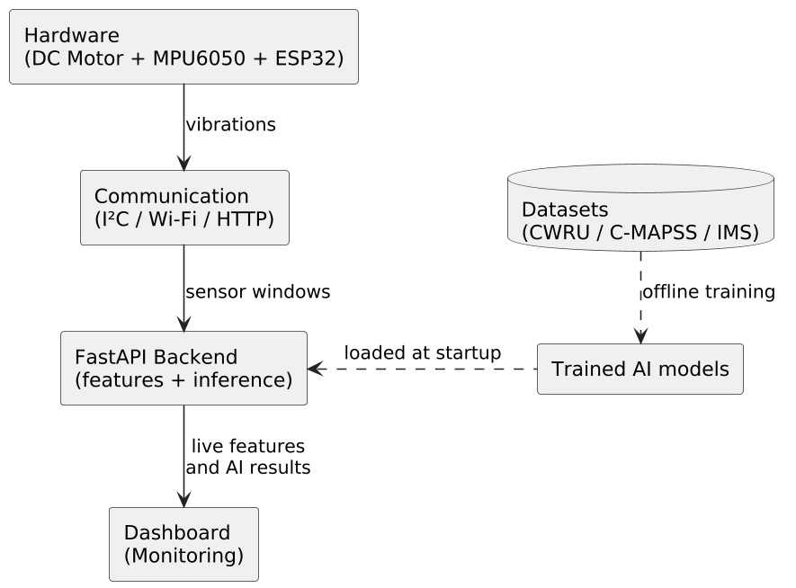
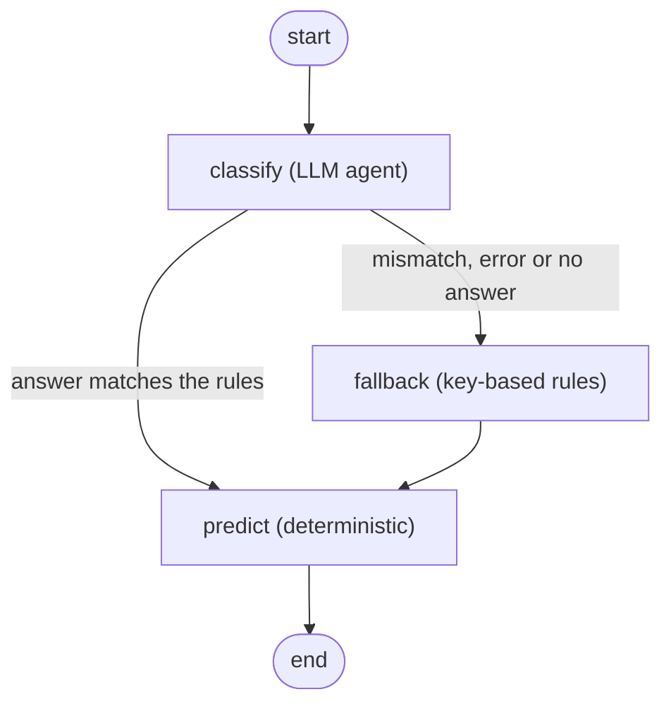
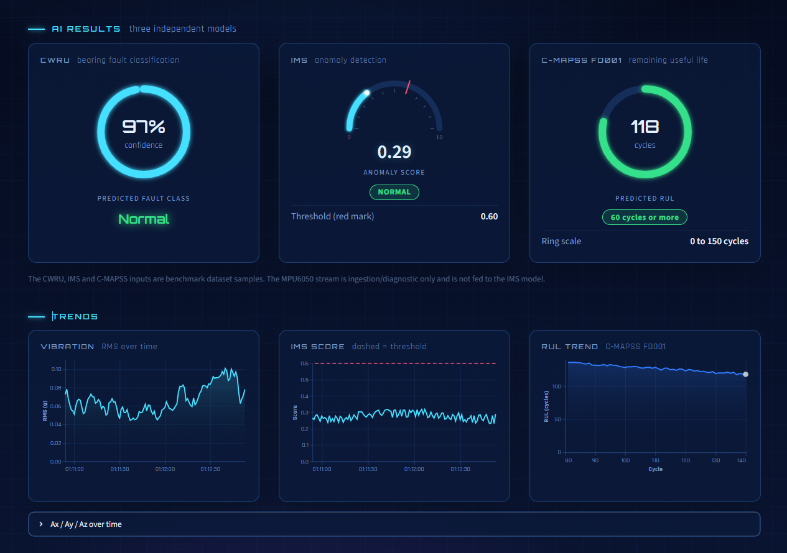

# Intelligent Bearing Fault Detection and Remaining Health Assessment

A predictive maintenance system for industrial machines, combining three AI models (fault classification, remaining useful life prediction, anomaly detection), a real-time IoT pipeline, an LLM-assisted routing layer, and a monitoring dashboard.

## 🎯 Objective

Detect bearing faults, estimate a motor's Remaining Useful Life (RUL), and detect vibration anomalies in real time, using sensor data from an ESP32-based IoT setup.

## 🏗️ Architecture

```
Machine/Motor → Sensors (MPU6050) → ESP32 → Wi-Fi/MQTT → Backend (FastAPI) → AI Models → Frontend (dashboard)
```



## 🧠 AI Components

| Component | Dataset | Task | Final model | Reported result |
|---|---|---|---|---|
| 1 — Fault classification | CWRU (Case Western Reserve University) | Normal / Ball fault / Inner-race / Outer-race | XGBoost | 0.71 macro-F1, 0.97 ROC-AUC |
| 2 — RUL prediction | NASA C-MAPSS (FD001) | Remaining Useful Life | LSTM | 13.35-cycle RMSE |
| 3 — Anomaly detection | NASA IMS | Unsupervised anomaly detection (vibration signals) | Isolation Forest (trained on healthy data only) | Flagged sustained degradation 4.7 days before the end of the run |

The evaluation protocols are in `final-notebooks/`.

## 🤖 Agents (LangGraph + Ollama)

The `agents/` package routes an incoming request to the right prediction pipeline (CWRU, IMS or C-MAPSS), then returns the prediction with a summary.



- **classify:** a local LLM (Ollama, tool calling) receives a structural summary of the payload (key names, types and lengths, never the raw sensor values) and proposes a pipeline. Small models sometimes skip the tool call, so the call is retried up to 3 times.
- **route:** the answer is accepted only if it matches the deterministic key-based rules in `agents/rules.py`. Small models report meaningless confidence values, so the model's own confidence is not used.
- **fallback:** on a mismatch, an error or no answer, the rules decide.
- **predict:** runs the same inference functions as the FastAPI endpoints. The summary is built from the structured result, never from LLM text, so the model cannot invent or misread numbers.

### Run it

Install [Ollama](https://ollama.com/download), then:

```bash
ollama pull llama3.2:3b
python tools/test_graph.py
```

The default model is `llama3.2:3b`. To use another one, set `AGENT_LLM_MODEL` (PowerShell: `$env:AGENT_LLM_MODEL = "llama3.1:8b"`).

### Routing evaluation

`python tools/eval_routing.py --runs 20 --attempts N` uses synthetic payloads with the real structure and measures routing only (no prediction is run). Raw reports are in `docs/`.

| Model | Attempts per call | Calls | Valid answers | Wrong routes |
|---|---|---|---|---|
| llama3.2:3b | 1 | 60 | 51 (85%) | 0 |
| llama3.2:3b | up to 3 | 60 | 60 (100%) | 0 |
| llama3.1:8b | up to 3 | 30 | 26 (87%) | 0 |

With a single attempt, all 9 failures of the 3B model had the same cause: it wrote the tool call as JSON text instead of invoking it. Retrying removed them in a 60-call run. The 8B model's 4 failures were not classification errors: the local Ollama server process crashed (exit status 0xc0000409). It also took roughly 4 to 6 times longer per call on CPU (5 to 10 s against 1 to 1.5 s), so the 3B model is the default.

No model chose the wrong pipeline. Zero failures in 60 calls does not mean the failure rate is zero, so the rule-based fallback stays in place; it did not need to fire in the 3-attempt run and is covered by unit tests with a mocked LLM. The payloads are synthetic and easy to tell apart, and the 8B sample is small, so this measures routing only and is not a verdict on the 8B model.

### Limitations

- A payload whose shape the rules do not recognise raises `ValueError`.
- Summaries for IMS and C-MAPSS are generic; only CWRU has a dedicated format.
- The agent layer is not yet exposed as a FastAPI endpoint.
- IMS anomaly results on the `2nd_test` run have not yet been cross-checked against the original notebook's own scoring.

## 📁 Project structure

```
├── final-notebooks/         # Final training/analysis notebooks for the 3 components
│   ├── cwru/
│   ├── cmapss/
│   │   ├── ML/
│   │   ├── DL/
│   │   └── model_comparison.ipynb
│   └── ims/
├── models/
│   └── production/          # Final trained models used by the API
├── src/                     # Core source code
├── api/                     # FastAPI backend
│   ├── app.py
│   ├── model_loader.py
│   ├── inference_cwru.py
│   ├── inference_cmapss.py
│   ├── inference_ims.py
│   ├── inference_sensor.py
│   └── schemas.py
├── agents/                  # LLM routing + LangGraph orchestration
│   ├── classifier_agent.py  # LLM agent that proposes a pipeline (with retries)
│   ├── predictor_agent.py   # deterministic prediction + summary
│   ├── rules.py             # key-based routing rules (the safety net)
│   ├── graph.py             # LangGraph graph: classify -> predict / fallback
│   ├── llm_client.py        # Ollama tool-calling wrapper
│   └── router.py            # earlier sequential pipeline (LLM classifier, then LLM predictor)
├── frontend/                # Dashboard application
├── IoT equipments/          # ESP32 firmware, MPU6050 wiring, MQTT publishing
├── integration_material/    # Real hardware setup (components, wiring docs, photos)
├── vibration_test/          # Real vibration test setup and recorded results
├── tests/                   # Automated tests (pytest)
│   ├── conftest.py
│   ├── test_cwru.py
│   ├── test_cmapss.py
│   ├── test_ims.py
│   ├── test_sensor.py
│   ├── test_health.py
│   ├── test_agent_rules.py
│   ├── test_agent_graph.py
│   └── test_agent_classifier.py
├── tools/                   # Utility scripts (payloads, model inspection, agent runs)
│   ├── generate_test_payloads.py
│   ├── generate_real_test_payloads.py
│   ├── inspect_models.py
│   ├── test_api.py
│   ├── test_agents.py       # original sequential agent pipeline on real models
│   ├── test_graph.py        # LangGraph pipeline on real models
│   ├── eval_routing.py      # routing evaluation
│   └── sample_payloads/
├── docs/                    # Figures and routing evaluation reports
├── pytest.ini
└── requirements.txt
```

## ⚙️ Installation

```bash
git clone https://github.com/bensaid25/bearing-fault-detection-rha.git
cd bearing-fault-detection-rha
python -m venv venv
source venv/bin/activate   # or venv\Scripts\activate on Windows
pip install -r requirements.txt
```

The agent layer also needs the [Ollama](https://ollama.com/download) application and a pulled model (see [Agents](#-agents-langgraph--ollama)). The rest of the project does not.

## 🚀 Usage

**1. Run the API (FastAPI)**
```bash
uvicorn api.app:app --reload
```

**2. Run the IoT sensor stream**
```bash
# See IoT equipments/README.md for ESP32 flashing and MQTT setup
```

**3. Run the frontend**
```bash
cd frontend
streamlit run app.py
```

## ✅ Tests

37 automated tests:

- **25 API tests** (`test_cwru.py`, `test_cmapss.py`, `test_ims.py`, `test_sensor.py`, `test_health.py`) covering the prediction endpoints. They load the models in `models/production/`.
- **12 agent tests** (`test_agent_rules.py`, `test_agent_graph.py`, `test_agent_classifier.py`) covering the routing rules, the graph and the classifier retries. The LLM is mocked, so they need neither Ollama nor the model files.

```bash
pytest tests/
pytest tests/test_agent_rules.py tests/test_agent_graph.py tests/test_agent_classifier.py   # agent layer only
```

Utility scripts in `tools/` generate test payloads (`generate_test_payloads.py`, `generate_real_test_payloads.py`) and inspect loaded models (`inspect_models.py`).

## 📦 Models

The final trained models are included in the repository under `models/production/`, so the pipeline runs after cloning.

Verify that the models load correctly with:
```bash
python tools/inspect_models.py
```

## 🔧 Hardware setup

- `IoT equipments/` — ESP32 + MPU6050 firmware and wiring
- `integration_material/` — full real-world hardware integration (components used, wiring diagrams, setup photos)
- `vibration_test/` — real vibration test bench setup and recorded results

## 📊 Demo




## 📜 License

This project is licensed under the MIT License.
